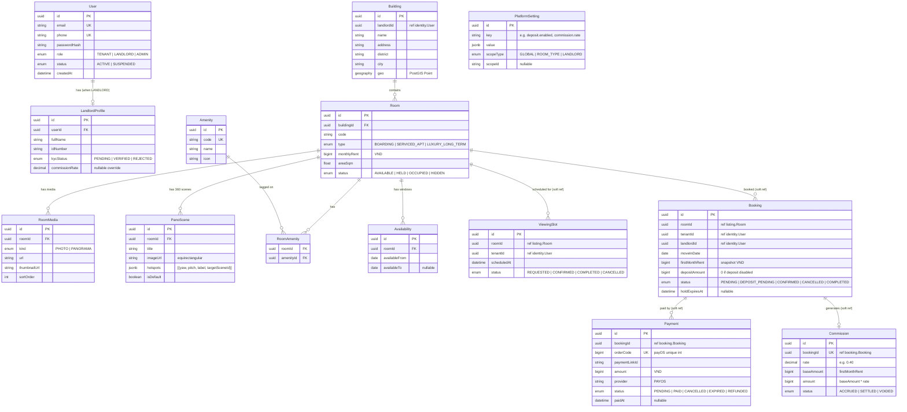

# RoomHub - Core ERD & Schema Specification

Mỗi microservice sở hữu một PostgreSQL schema độc lập trong database `roomhub` (khởi tạo bởi `infrastructure/docker/init-db/01-init-schemas.sql`). Tham chiếu giữa các schema dùng UUID (không tạo foreign key cứng xuyên schema).

## 1. Tổng quan ERD



## 2. Quy tắc nghiệp vụ dữ liệu bắt buộc

1. **Hoa hồng (Commission):**
   - Công thức: `amount = firstMonthRent × rate`.
   - Thời điểm ghi nhận: ngay khi `Booking` chuyển sang `CONFIRMED`.
   - Cọc (`depositAmount`) và hoa hồng (`Commission.amount`) là hai khoản độc lập.
2. **Độ ưu tiên cấu hình `PlatformSetting`:**
   - Khi tra cứu `deposit.*` hoặc `commission.rate`, thứ tự ưu tiên:
     `LANDLORD (scopeId = landlordId)` → `ROOM_TYPE (scopeId = room.type)` → `GLOBAL`.
   - Các key chuẩn:
     - `deposit.enabled` (`boolean`)
     - `deposit.mode` (`"PERCENT" | "FIXED"`)
     - `deposit.value` (`number`)
     - `deposit.hold_hours` (`number`)
     - `deposit.refund_policy` (`object`)
     - `commission.rate` (`number`, mặc định `0.40`)
3. **Cấu trúc `PanoScene.hotspots`:**
   ```json
   [
     {
       "yaw": 120.5,
       "pitch": -5.0,
       "label": "Sang phòng ngủ",
       "targetSceneId": "uuid-of-target-scene"
     }
   ]
   ```
4. **Idempotency webhook thanh toán:**
   - Bảng `payment.WebhookEvent` (cần thêm khi vào GĐ 3) lưu `providerEventId` / `orderCode` + `checksum` để chống xử lý trùng webhook payOS.
